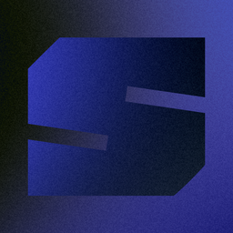
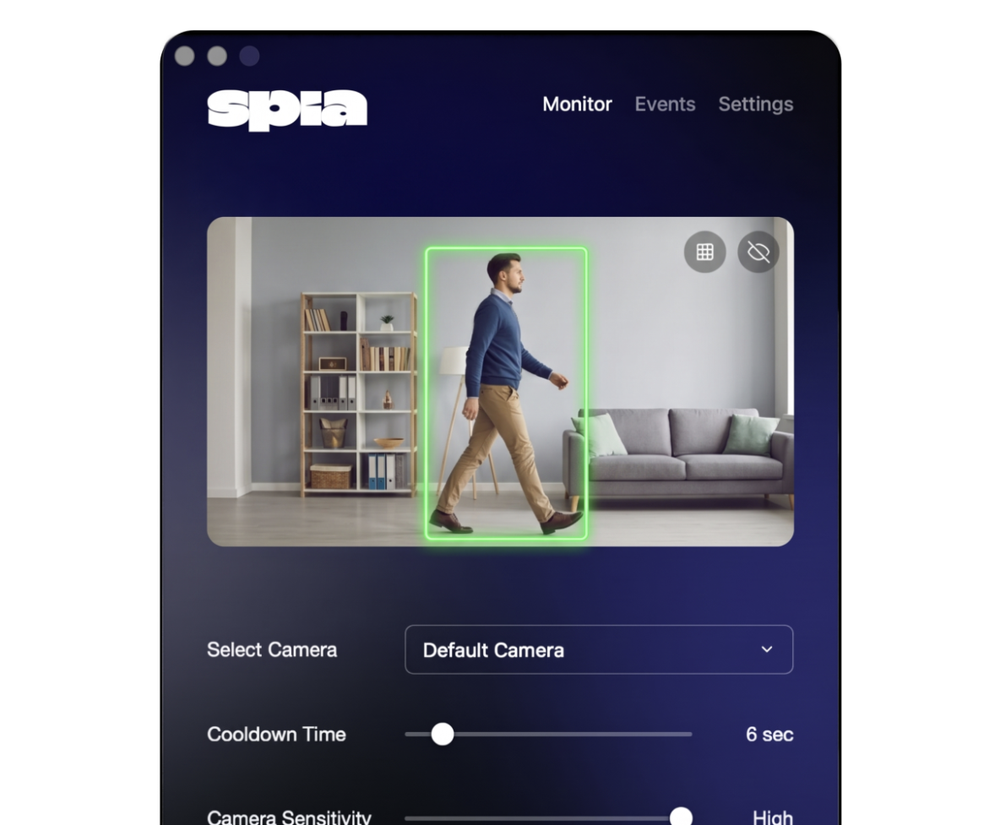
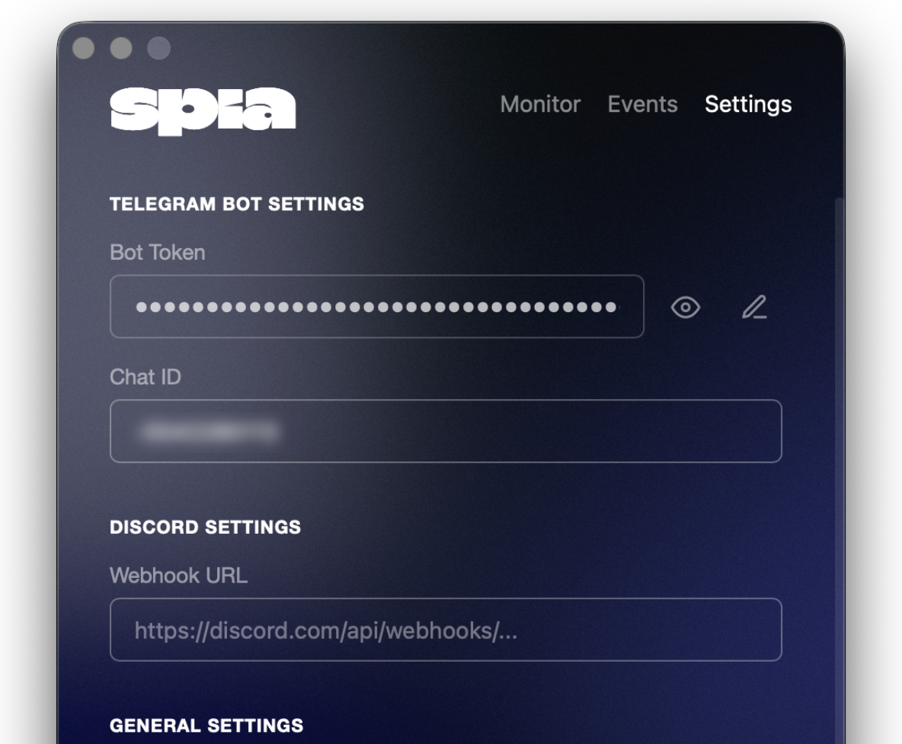
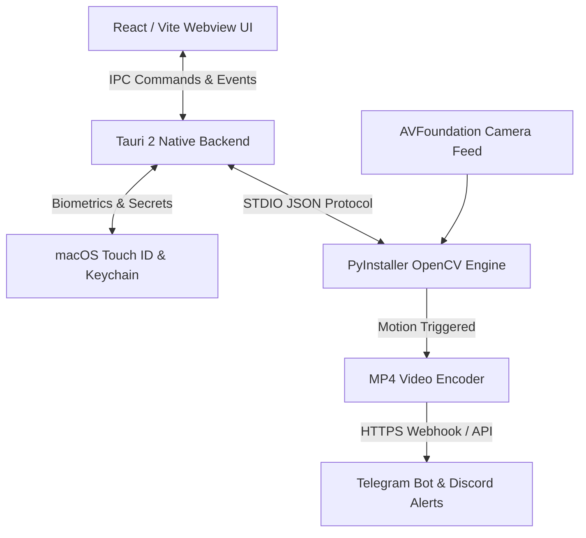

<p align="center">
  
</p>

<h1 align="center">SPIA</h1>

<p align="center">
  <strong>Intelligent camera motion surveillance and alert dispatch for macOS.</strong>
</p>

<p align="center">
  <a href="https://github.com/qn34uc59t/spia/actions/workflows/ci.yml"></a>
  <a href="https://github.com/qn34uc59t/spia/releases"></a>
  
  
  
  
</p>

---

## What is SPIA?

**SPIA** is a discreet, native macOS motion detection and surveillance system. Operating quietly from your macOS menu bar, SPIA monitors camera feeds using an optimized OpenCV computer vision pipeline running locally on your hardware.

When motion is detected in your monitored space, SPIA instantly triggers automated video capture and securely dispatches high-definition MP4 clips to your configured **Telegram** or **Discord** channels.

---

## Interface & Preview

<p align="center">
  
</p>
<p align="center">
  <em>Discreet menu bar surveillance console with instant arming, live state, and quick logs.</em>
</p>

<br />

<p align="center">
  
</p>
<p align="center">
  <em>Interactive 12x12 zone masking grid to ignore static backgrounds, ceiling fans, or pets.</em>
</p>

---

## Key Features

- **Advanced Motion Detection:** OpenCV-driven optical change tracking with customizable sensitivity thresholds.
- **12x12 Interactive Zone Masking:** Ignore windows, trees, pets, or fans with granular click-to-mask exclusion tiles.
- **Biometric Keychain Protection:** Telegram tokens and Discord webhooks are encrypted in the macOS Keychain and protected via Touch ID authentication.
- **Automated Video Dispatch:** Instantaneous MP4 packaging and dispatch via Telegram Bots or Discord Webhooks.
- **Prevent Mac Sleep:** Built-in macOS keep-awake assertion ensures continuous background vigilance while on battery or adapter.
- **Zero-Cloud & 100% Local:** All frame analysis, detection algorithms, and disk management execute on your Mac.

---

## Installation

### Method 1: Homebrew (Recommended)

```bash
brew install --cask qn34uc59t/tap/spia
```

Quarantine flags are automatically bypassed during installation. Update with:
```bash
brew upgrade spia
```

### Method 2: Pre-built DMG Installer

1. Download **`SPIA-v0.1.4.dmg`** from [GitHub Releases](https://github.com/qn34uc59t/spia/releases).
2. Open the disk image.
3. Drag **SPIA.app** to your `/Applications` folder, or double-click **Install SPIA.command**.
4. Launch SPIA from Spotlight or Launchpad.

---

## Architecture

SPIA pairs the speed and battery-efficiency of native macOS components with a high-performance Python computer vision sidecar:



- **Frontend:** Lightweight React UI with transparent glass styling running in Tauri.
- **Backend (Rust):** Handles OS-level integrations, Touch ID authentication, LaunchAgent autostart, and system tray management.
- **Engine (Python Sidecar):** Runs as an independent compiled process (`spia-engine`) communicating with Tauri over JSON STDIO, guaranteeing the UI never drops frames during heavy encoding workloads.

---

## Building from Source

### Prerequisites

- Node.js 20+ & npm
- Rust (`rustup default stable`) with `aarch64-apple-darwin` target
- Python 3.12+

```bash
# 1. Clone repository
git clone https://github.com/qn34uc59t/spia.git
cd spia

# 2. Install dependencies
npm install
cd engine && pip install -r requirements.txt && cd ..

# 3. Build sidecar, application, and DMG
npm run build:all
```

---

## Security & Privacy Guarantee

- **No Remote Telemetry:** No tracking, telemetry, or diagnostic metrics are gathered or transmitted.
- **Direct Dispatch:** Video evidence is routed exclusively to endpoints explicitly provided by you (your own Telegram Bot or private Discord Webhook).
- **Entitlements:** Camera permissions are requested through Apple's native Privacy TCC model.
